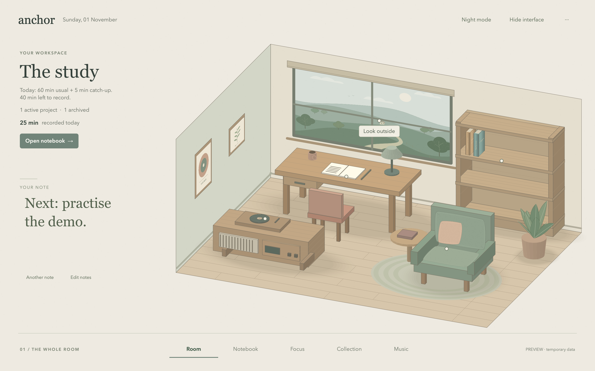
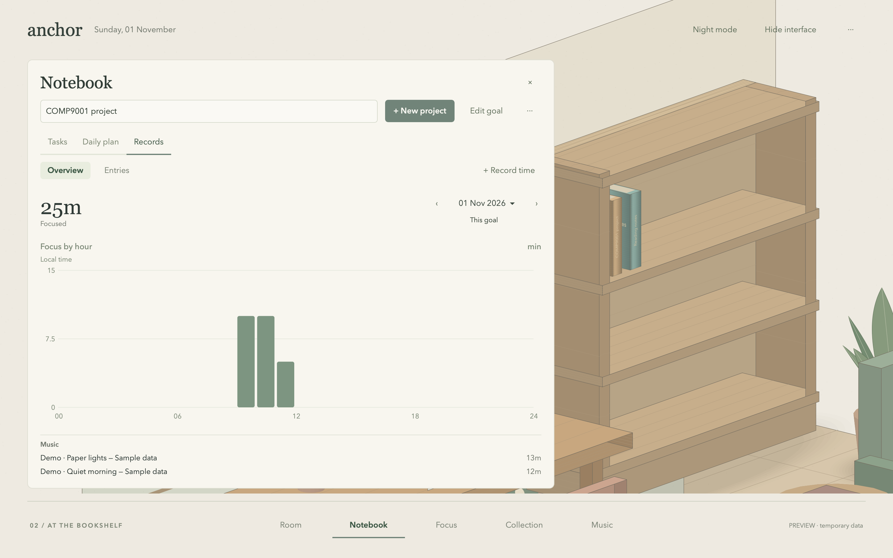

# Anchor

A Python desktop study room for planning projects, recording focused work and keeping a book for each project.



## Install

Download from [Anchor 1.1.0](https://github.com/JiyuZhong/Anchor/releases/tag/v1.1.0).

| Download | Use |
| --- | --- |
| `Anchor-macOS-AppleSilicon.zip` | Mac app with Python and Qt included. Extract and open `Anchor.app`. |
| `Anchor-Source.zip` | Portable source, requirements, installation guide and interface screenshots. |
| `Anchor-Offline-Source.zip` | Source and local Qt wheels for macOS, Windows x86_64 and Linux x86_64. Requires Python. |
| `Anchor-Ed-Code.zip` | Python files and running instructions prepared for the course submission. |

Source and offline setup require **CPython 3.10–3.13**. The pinned dependency is `PySide6-Essentials==6.8.3`; Python 3.14 is not supported. See [INSTALL.txt](INSTALL.txt) for platform-specific steps.

```sh
python3 -m venv .venv
.venv/bin/python -m pip install -r requirements.txt
.venv/bin/python app.py --preview
```

On Windows, use `py -3.12` and `.venv\Scripts\python.exe`. On macOS, `Launch Anchor.command` can set up the environment. The Mac app is ad-hoc signed and not Apple-notarised; macOS may require its standard Open Anyway approval. Only macOS execution has been checked locally.

## In the room

- Create dated projects or ongoing daily goals, with tasks and subtasks.
- Start, pause and save focus sessions, or backfill work and undo the latest record change.
- Enable optional catch-up: extra time is capped at 15 minutes, 25% of the daily goal and spare daily capacity. Ongoing goals consider only yesterday's shortfall.
- Review saved focus intervals and observed music in hourly statistics. Confirmed work minutes remain separate from observed timing.
- Customise book covers, spines and shelf positions. Archive finished or unfinished projects and reopen them with their history.
- Use day/night views, personal notes and UI-free immersion. Spotify and Apple Music controls are optional and macOS only.



Preview projects and music entries are fictional. Preview changes are discarded on exit. Normal source profiles are stored in `data/`; the bundled Mac app uses `~/Library/Application Support/Anchor/`. Back up the whole profile, including imported images. Unsaved active timers cannot be recovered after a crash.

## Source layout

`app.py` starts the program. `planner/` handles models, calculations, observations and JSON storage. `desktop/` contains the native interface and room drawing. `tools/` builds source and installation packages. [The architecture guide](docs/ARCHITECTURE.md) explains the main data flow.

The core walkthrough uses Python's standard library:

```sh
python3 app.py --demo
```

For the course, follow [README_ED.txt](README_ED.txt): Python files and README still need direct submission to Ed. A release link alone does not replace that submission.
